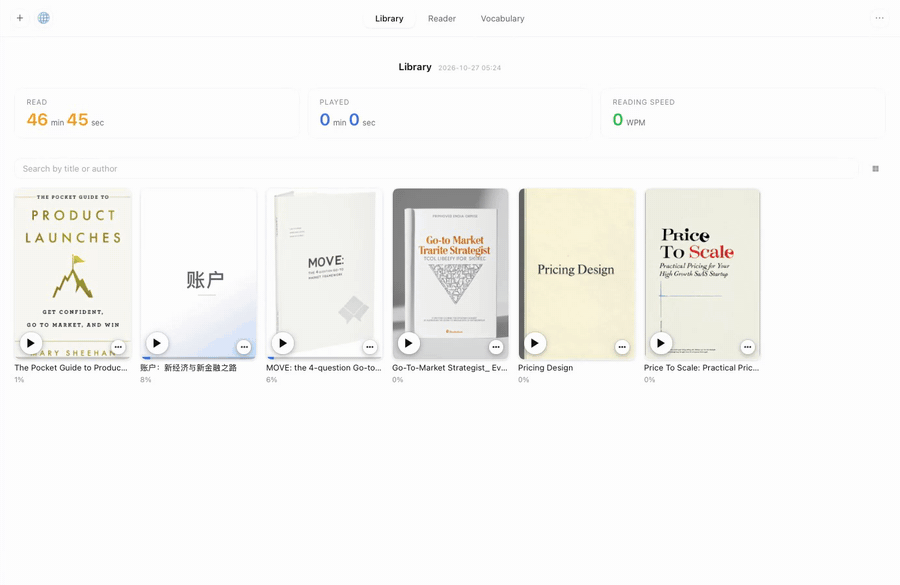
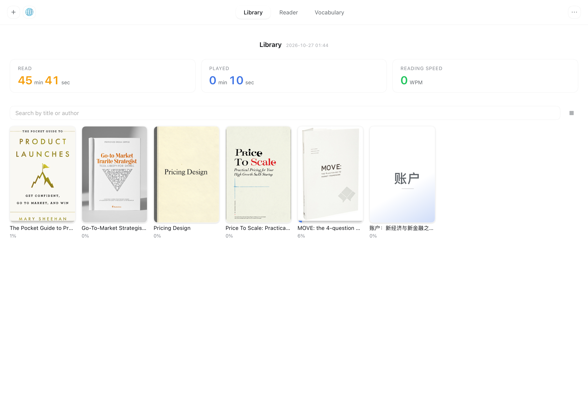
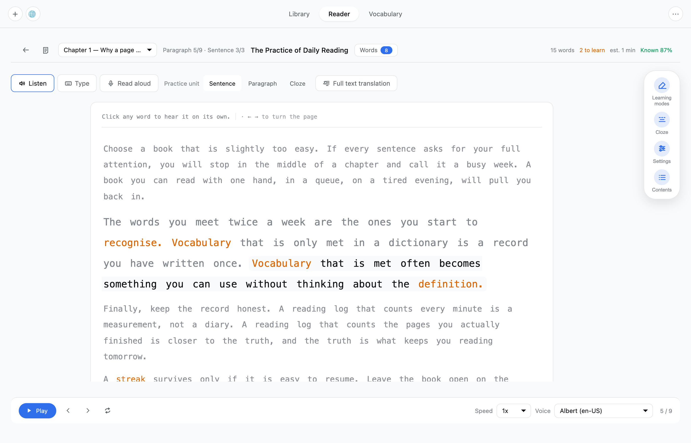
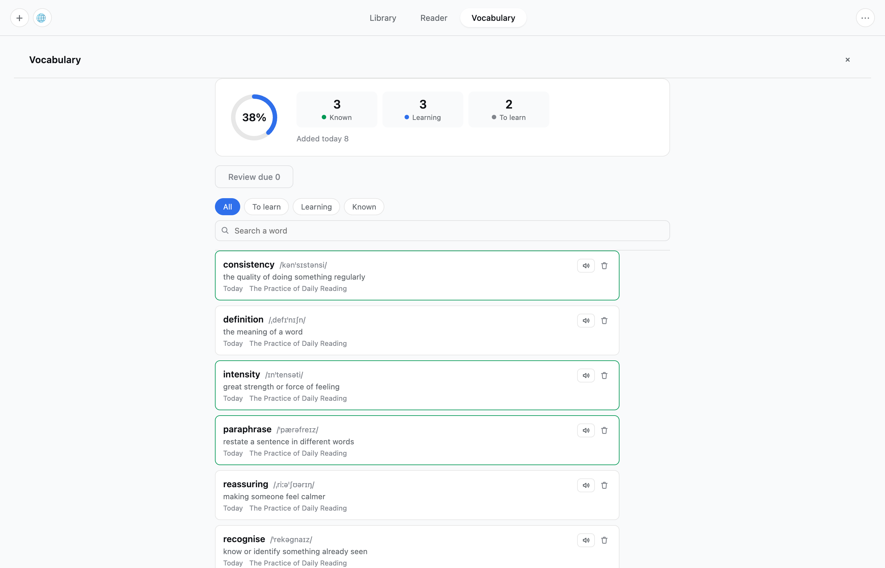

# Reader for DeepSeek Harness

Import an ebook, then read it sentence by sentence — **listen to it**, **type
along with the speech**, or **read aloud and check the transcript**. Your
books stay on your machine, in one library that the desktop app and every
browser share.

The plugin adds a **Reader** panel to the left sidebar of the
DeepSeek Harness. Everything the learner uses runs in the page: the file
import, the parsing, the matching UI and the speech recognition.

> 中文说明：导入 EPUB / TXT / Markdown / HTML / PDF 后逐句精读——听朗读、跟着
> 同步语音打字、或朗读后与原文比对。**书库由宿主托管并落盘**，桌面应用与浏览器
> 共用同一批书，文件不出本机。完整的中文技术文档见
> [`plugin/README.md`](plugin/README.md)。

## Demo

The recording below is the real plugin, running in the Harness web UI against a
real shelf: the library, a book open in the reader, the word card answering
for a tapped word, and the vocabulary list.



> The GIF is 40 seconds. The same walk-through is available as
> [`demo.mp4`](docs/demo.mp4) (1384×900, 775 KB).
>
> The recording and the screenshots below are taken from the running
> application, not from the preview harness, so they show the plugin as it
> behaves. The application's own sidebar is collapsed to its icon rail: it
> lists the reader's own sessions, which are nobody else's business.

## What you get

| | |
| --- | --- |
| **Import** | drag in an **EPUB, TXT, Markdown, HTML or PDF**; PDF is loaded through a lazy chunk, so the first screen stays fast |
| **Library** | a shelf with cover thumbnails (or a list), search, and three read statistics: time read, time played, reading speed |
| **Per book** | listen straight from the cover — the play button sits on the artwork and is always there, no hovering — plus word frequency, book details, rename, delete, and an AI-drawn cover when the book has none |
| **Listen** | read the current practice unit aloud with word-level highlighting; adjustable speed (0.5x–2x) and voice, and a loop. The voice list follows the book's language: an English book gets English voices, a Chinese book gets Chinese ones |
| **Type** | type **in place**, in the paragraph itself — the current word is highlighted, mistakes are marked red, accuracy and speed sit above, and the speech follows what you type |
| **Read aloud** | speech recognition is transcribed and aligned word by word with the original, marking what you skipped, misread or added; falls back to a recording you grade yourself |
| **Chinese books** | they read. Chinese sentences end at `。！？`, every character is a word, the punctuation stays on the page instead of vanishing, and the voices and the recogniser follow the language of the book |
| **Tap a word** | a word card with phonetics, part of speech, definition, examples — and how the word reads in *this* sentence, generated live |
| **Vocabulary** | star a word to keep it: a drawer with a progress ring (known / learning / to learn), today's additions, search and filters |
| **Spaced review** | a saved word enters the review queue immediately, scheduled 1 / 2 / 4 / 7 / 15 / 30 days out |
| **Online library** | search Project Gutenberg and import a public-domain book without leaving the app |
| **Notes** | a note per sentence, kept next to the book in the Host's shelf |

## The library

The shelf: covers, the three read statistics, search, and the per-book menu.



## The reader

One book, opened. The paragraph is the practice surface: the current
sentence is highlighted, the rest is context, and the word you collected
earlier keeps its colour.



## The vocabulary list



## Install

```bash
git clone https://github.com/colsonSung/dsh-reader.git
cd dsh-reader
./install.sh              # installs into the profile of the running Harness
```

`install.sh` takes an optional profile name (`./install.sh web`) and is
idempotent. It installs the package into the profile and adds the bundle row
to `<profile>/cordis.patch.yml`. **Restart the Harness afterwards** — the
host half of a plugin is loaded at start-up.

Manual equivalent:

```bash
dsh plugin --profile web add ./plugin
```

```yaml
# <profile>/cordis.patch.yml
- insert:
    - id: reader
      name: 'dsh-reader'
```

After the restart, a **Reader** icon appears in the left sidebar's
Global panels.

## Optional: the AI channel

Everything above works with no key at all. The browser's own Web Speech API
provides the voices, and the Harness's own model answers the word cards.

If you want the cloud voices, the speech recognition and the AI-drawn
covers, give the Host half a MiniMax key. It is read from the environment, or
from a private file outside the workspace:

```bash
export MINIMAX_API_KEY=...                          # 1. the environment
mkdir -p ~/.dsh/reader && echo -n '...' \
  > ~/.dsh/reader/minimax.key && chmod 600 \
  ~/.dsh/reader/minimax.key                  # 2. a private file
```

The key never enters the bundle and never reaches the browser. With no key
the plugin degrades quietly: word cards fall back to the Harness model,
cloud voices fall back to the browser's.

## Optional: the online library

The 🌐 button in the library opens Project Gutenberg. The catalog is fetched
once by the Host (it is about 21 MB, so it does not belong in a bundle) and
cached under `~/.dsh/reader/` for seven days.

## How it works

The plugin has two halves.

The **client half** is the panel: it parses the file in the page, reads and
writes the shelf through the Host, renders the shelf and the reader, and
drives the Web Speech APIs. It registers one sidebar panel icon and one main
page.

The **host half** owns the three things a page cannot do safely: it holds the
API key, it talks to the provider, and it owns the library on disk. It
registers one route, `/api/reader`, through the Connection service's
Fetch registry, so the caller is authenticated with the same browser session
the rest of the application uses:

| Method | What it does |
| --- | --- |
| `word` / `translate` / `breakdown` | the AI assist answers, with the Harness model as the fallback |
| `tts` | the reading voice, synthesised by the provider |
| `asr` | the transcription of your own reading |
| `cover` | a generated book cover |
| `voices` | the available voices |
| `status` | which channels are available |
| `source` | the Gutenberg catalog search and download |
| `shelf` | the library itself: books, vocabulary, notes and podcasts |

## Where the library lives

The shelf belongs to the Host and is written to disk under the profile:

```
<profileDir>/reader/
├── books/<bookId>.json      one file per book, the whole record
├── vocabulary.json
├── notes.json
└── podcasts.json
```

It used to live in the browser's IndexedDB, and that was a trap: IndexedDB is
scoped per origin, so the desktop app (`dsh-app://app`), a browser tab
(`http://127.0.0.1:<port>`) and the next run of the app (a **different port**)
each had their own, unrelated library. The books were never lost — they were
in another origin's storage. Now the Host owns them: every window sees the
same shelf, across browsers, ports and restarts.

Writes are atomic (write a `.tmp`, then rename), a corrupt file is skipped
rather than fatal, and records are stored as they are — the Host never drops
a field it does not know. Writing the reading position travels as a progress
patch, so a few bytes cross the wire instead of the whole book on every
sentence.

A browser that still holds books hands them over the first time the plugin
loads: the Host takes a collection only when it has none of it, so a book you
deleted does not come back. The browser's own IndexedDB stays as the fallback
for a Host that has not been restarted yet.

The full protocol is in
[`plugin/docs/CONTRACT-SHELF.md`](plugin/docs/CONTRACT-SHELF.md).

## Preview harness

The shelf and the reader can be rendered without a running Harness. The
preview mounts the real page component with a mock client context and a
seeded shelf:

```bash
cd plugin
node tools/preview/build.mjs    # → tools/preview/preview.bundle.js
cd tools/preview
python3 -m http.server 8080
# then open http://localhost:8080/   (add ?view=reader for the reading page)
```

There is no Host in the preview, so the demo shelf is seeded into the
browser's IndexedDB — exactly the fallback the reader uses when the Host has
no shelf yet. IndexedDB needs a real origin, so the preview must be served
over http.

## Build and test

```bash
cd plugin
pnpm install
node build.mjs                 # → client.js and client.pdf.js
node --test tests/*.test.mjs    # 310 passing
```

`client.js` and `client.pdf.js` are the shipped browser bundles and are
committed, so a clone installs without a build step. The build is only needed
after editing `plugin/src/`.

The build stamps the current time into the bundle and the page shows it, so a
window that still holds an older bundle is recognisable at a glance. That
also means `client.js` is **not** byte-reproducible across builds.

## Repository layout

```
plugin/              the DeepSeek Harness bundle
  index.js           the Host half: the /api/reader route
  src/client-entry.js  the client half: panel icon, page, dictionaries
  src/host/          the Host services: the shelf on disk, AI, MiniMax, Gutenberg
  src/lib/           parsers, the reading engine, the shelf client and its fallback
  src/ui/            the shelf, the reader, the word card, the vocabulary
  tests/             310 tests over the parsers, the engine, the shelf and the UI
  tools/preview/     a standalone harness that renders the reader
docs/                the screenshots and the demo recording
install.sh           installs the bundle into a profile
```

## Known limits

* **Scanned PDFs** have no text layer to extract. The plugin says so and
  asks for an EPUB or TXT instead.
* **Speech recognition** needs the browser's Web Speech API. It works in
  Chrome and Safari; some Electron runtimes have no recognition service, and
  the plugin then degrades to "record it back and grade yourself".
* **Browsers that do not dispatch `boundary` events** (Safari, Firefox) fall
  back to an estimate for the word-level highlighting.
* **MOBI / AZW3 / FB2** are not supported: there is no reliable pure-frontend
  parser for them, so the import is refused with a clear message.
* A book with one chapter is listed by paragraph instead of by chapter.
* **The Host half needs a restart.** The shelf is served by the Host, so a
  change to `plugin/index.js` or `plugin/src/host/` only takes effect after
  the Harness is restarted. Until then the client falls back to the browser's
  own IndexedDB — the reader keeps working, the shelf is just not shared yet.
* **`shelf` lists whole books.** The shelf view needs the text to count words
  and words frequencies, so `books.list` returns every book in full. That is
  fine for a handful of books and gets slow with a large library; writing the
  reading position travels as a progress patch and is not affected.
* **Chinese is counted one character per word.** Without a Chinese word
  segmenter the vocabulary list and the word frequencies work in single
  characters, not in words. The percentage of a Chinese book is therefore
  smaller than it used to be — a book of 2,305 characters is 2,305 words, not
  514. The reading record itself is untouched.
* **`…` always ends a sentence.** In an English book "Wait… what" is cut in
  two. The book in the demo has four such ellipses; a book full of them would
  need the rule tightened.
* **One local Chinese voice.** macOS ships one Mandarin voice (Ting-Ting); the
  other 64 Chinese voices come from the MiniMax channel, which needs a key.

## License

[MIT](LICENSE) © 2026 Ethan Song
